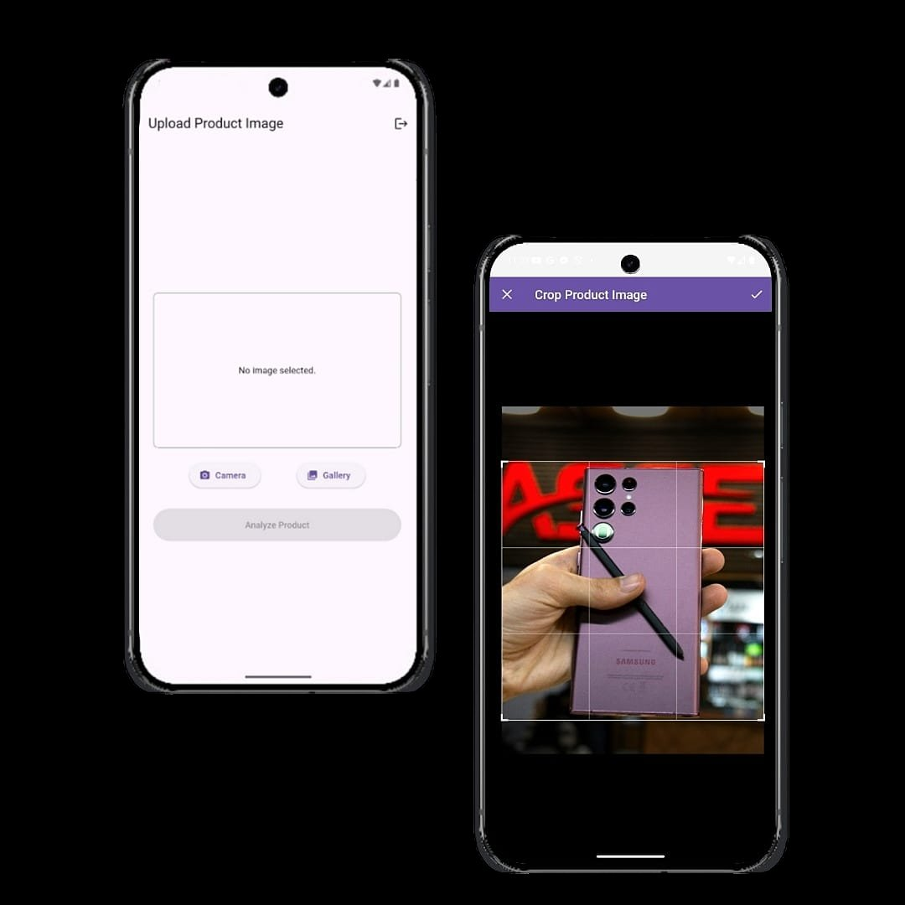
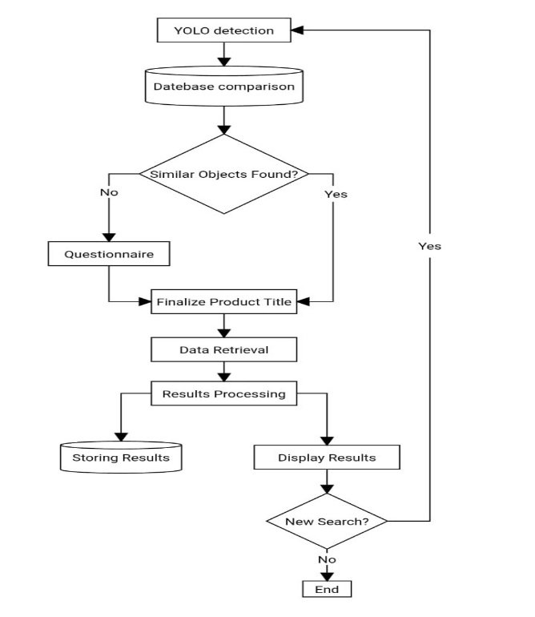
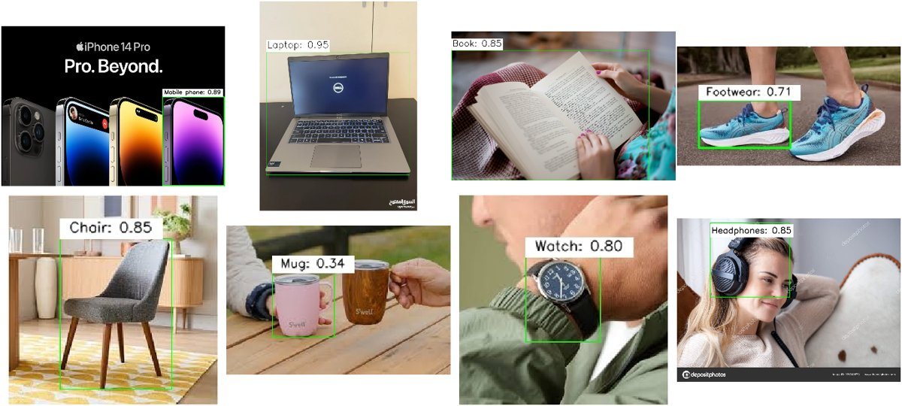
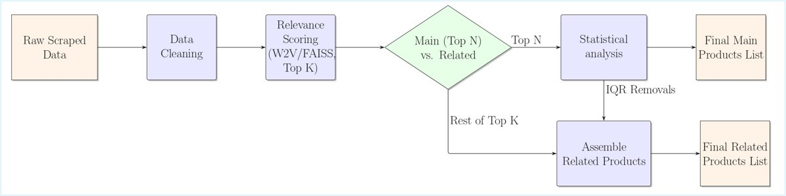
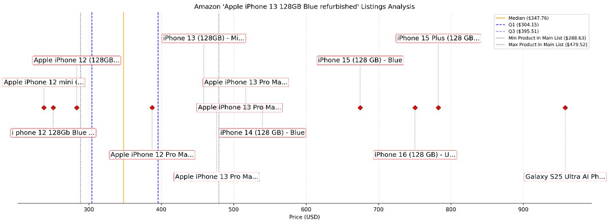
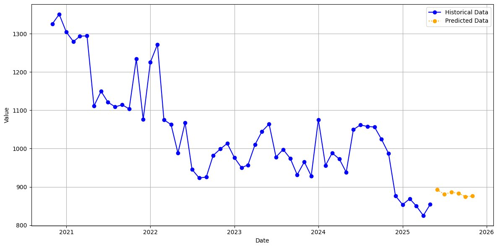
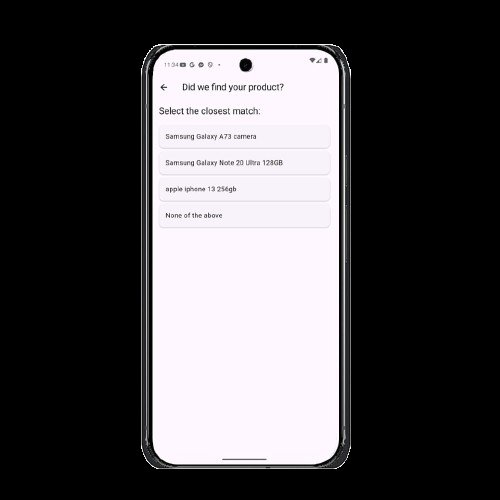
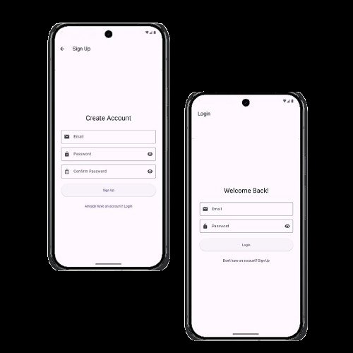
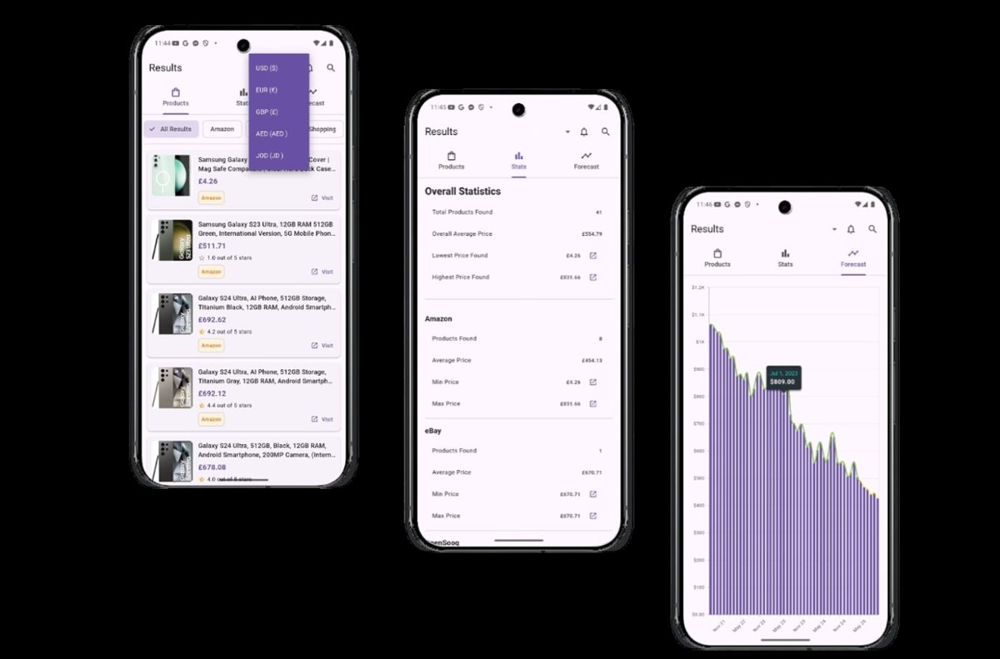

# Etsawakli: Smart Object Detection and Price Prediction for E-Commerce

**Graduation project, B.Sc. Computer Engineering, University of Jordan (June 2025). Grade: A.**
Supervised by Dr. Ramzi Saifan.

Take a photo of a product. Etsawakli identifies it, collects live prices from Amazon, eBay, Google Shopping and OpenSooq, filters out irrelevant and anomalous listings, forecasts where the price is heading, and alerts you when it drops.

<p align="center">
  
  
  
</p>

## The problem

- Comparing prices by hand across many sites is slow.
- Dynamic pricing makes it hard to know when to buy.
- Identifying a product from a photo or a vague idea is hard.
- Few consumer tools predict where a price is heading.

Etsawakli handles all of this in one flow: snap a photo, confirm the product, and get the market picture plus a forecast.

## How it works

<p align="center"></p>

### 1. Product recognition

**Detection.** YOLOv8m pretrained on Open Images V7 locates the main object. OIV7 (~600 classes) was chosen over COCO (~80 classes) because it separates product categories far more finely. A configurable list of irrelevant classes (people, animals and so on), stored in MongoDB, filters out non-product detections.

The model was chosen for its accuracy/latency trade-off on CPU. Figures are Ultralytics' published OIV7 benchmarks:

| Model | mAP<sup>val</sup> 50-95 | CPU ONNX (ms) | Params (M) |
|---|---|---|---|
| YOLOv8n | 18.4 | 142.4 | 3.5 |
| YOLOv8s | 27.7 | 183.1 | 11.4 |
| **YOLOv8m** | **33.6** | **408.5** | **26.2** |
| YOLOv8l | 34.9 | 596.9 | 44.1 |
| YOLOv8x | 36.3 | 860.6 | 68.7 |

YOLOv8x adds only 2.7 mAP for more than twice the latency, so the m variant was chosen.



**Visual matching.** The cropped object is embedded with ResNet-50 into a 2048-d vector. Feature vectors of previously processed products in the same YOLO category are loaded from MongoDB into an in-memory FAISS index, and the 3 closest unique products are offered to the user. Every completed search adds its features to the database, so recognition gets better as the system is used.

**Questionnaire fallback.** If nothing matches, or the user rejects the matches, GPT-4o-mini asks up to 5 context-aware questions, from general (brand, category) to specific (model, storage). The answers and any extra specs are merged into a clean, search-optimised "core title". Question paths are cached in MongoDB. That makes common paths near-instant, cuts LLM cost, and lets cached questions be reviewed or edited without touching code.

### 2. Data retrieval

A hybrid strategy, chosen per source:

| Source | Method | Why |
|---|---|---|
| Amazon, eBay, OpenSooq | Playwright (headless Chromium) | Heavy JavaScript and lazy loading. The official APIs carry commercial restrictions or return stale data. |
| Google Shopping | BrightData SERP API | Google's anti-bot measures make direct scraping unreliable. The API returns structured JSON. |

CSS selectors live in the MongoDB config, so a site layout change means a config edit, not a redeploy. Retrieval is limited to publicly accessible listings at modest request rates, extracting only the fields needed.

### 3. Cleaning and analysis

This is the stage that turns raw listings into a market summary.



1. **Normalisation.** Price strings are parsed for currency (USD, AED, JOD and others) and converted to USD. Price ranges are averaged, and unparseable prices are dropped.
2. **Relevance scoring.** A Word2Vec model is trained on the fly for each source, on that source's titles plus the query, so the vocabulary always matches the listings being scored. Core-title tokens are up-weighted in the query vector. Title vectors are indexed in FAISS (`IndexFlatL2`), and each listing gets a score of `1 / (d + ε)` from its distance to the query.
3. **Weighting and expansion.** The top 8 listings are replicated in proportion to relevance, so the closest matches count most in the statistics.
4. **IQR anomaly filtering.** Outlier prices are removed from the weighted set.
5. **Statistics.** Minimum, maximum and weighted average price are computed per source and across the whole market.
6. **Output.** Listings that pass become **main products**. Those dropped by relevance or IQR become **related products**, so accessories and neighbouring models still show up, just separately.


*Amazon results for "Apple iPhone 13 128GB Blue (refurbished)". Red diamonds are listings the pipeline moved to related products (other models such as the iPhone 12, 14 and 15, and a Galaxy S25 Ultra) before computing price statistics.*

### 4. Price forecasting

TimeGPT (Nixtla) forecasts future prices zero-shot from the item's price history. That avoids training and maintaining a separate model for every product. Prices are aggregated monthly to smooth out daily volatility while keeping the signal actionable.



### 5. Price-drop notifier

Users can subscribe to a product after their first search. APScheduler re-scrapes subscribed products every 24 hours, and Firebase Cloud Messaging pushes an alert when the price falls by **5% or more**: enough to matter, without spamming. A product with several subscribers is scraped once per cycle and the result is shared. When a drop is found, the user's session and the global products cache are both refreshed. Sessions with no subscription are cleaned up at startup.

## API

Authenticated with an `X-Auth-Token` header. Slow work runs as background tasks that the client polls.

| Endpoint | Method | Purpose |
|---|---|---|
| `/signup` | POST | Register with a bcrypt-hashed password |
| `/login` | POST | Authenticate and issue an auth token |
| `/users/me/fcm-token` | PUT | Register the device for push notifications |
| `/detect` | POST | Upload an image, run detection and matching, start a session |
| `/answer` | POST | Submit a match choice or questionnaire answer, finalise the title |
| `/scrape/{session_id}` | POST | Start a background scrape (cache checked first) |
| `/scrape-status/{session_id}` | GET | Poll scrape status and results |
| `/predict-prices/{session_id}` | POST | Start a background forecast |
| `/predict-prices/status/{session_id}` | GET | Poll forecast status and results |
| `/notify-subscribe/{session_id}` | PUT | Subscribe to or unsubscribe from price-drop alerts |

Scraped results are cached in MongoDB with a 24-hour TTL, so repeat searches skip the scrape entirely.

## Performance

Average response time per endpoint from load testing:

| Endpoint | Avg (ms) |
|---|---|
| `GET /scrape-status/{session_id}` | 10.88 |
| `POST /predict-prices/{session_id}` | 16.13 |
| `POST /scrape/{session_id}` | 16.70 |
| `POST /login/` | 484.68 |
| `POST /signup/` | 528.05 |
| `GET /predict-prices/status/{session_id}` | 546.38 |
| `POST /detect/` | 555.00 |
| `POST /answer/` | 1022.88 |
| **Aggregated** | **627.51** |

The scrape and forecast triggers return in about 16 ms because the heavy work happens in the background. `/answer` is the slowest because it waits on the LLM, which is exactly what the question cache exists to avoid.

## The app

<p align="center">
  
  
</p>



The Flutter app (Android first) covers sign-up and login, uploading and cropping a photo, choosing a match or answering the questionnaire, and results by marketplace with overall statistics and a price history chart.

## Stack

**Backend:** FastAPI, MongoDB (Motor), APScheduler, Firebase Admin, passlib/bcrypt
**ML / AI:** Ultralytics YOLOv8, PyTorch / torchvision (ResNet-50), FAISS, Gensim Word2Vec, OpenAI API, Nixtla TimeGPT
**Data collection:** Playwright, BrightData SERP API
**Frontend:** Flutter (not included in this repo)

## Team

| | |
|---|---|
| **Marwan Qedan** | Backend and AI pipeline: object detection, visual matching, LLM questionnaire, scraping, data processing and anomaly filtering, notifier, FastAPI service |
| **Albatoul Alfassi** | Flutter mobile app and the TimeGPT price predictor |

## Running it

```bash
cd backend
pip install -r requirements.txt
playwright install
```

1. Copy `global_config.example.json`, fill in your own API keys, and insert it into MongoDB as document `global_config` in `app_config.settings`. All runtime parameters (selectors, thresholds, model settings) live there, and the backend reads them via `CONFIG_MONGO_URI`, which defaults to localhost.
2. Run `uvicorn main:app --reload`. Swagger docs are served at `/docs`.

YOLO weights download automatically on first run.

## Limitations and future work

- **Selector fragility:** layout changes on target sites break the scrapers until the selectors are updated.
- **Third-party AI dependencies:** cost, uptime and output variability from the OpenAI and TimeGPT APIs.
- **Uneven data quality** across marketplaces, especially in local listings.

Next steps: more marketplaces, user feedback loops on match quality, personalised recommendations, and LLM-driven semantic scraping in place of fixed selectors.
